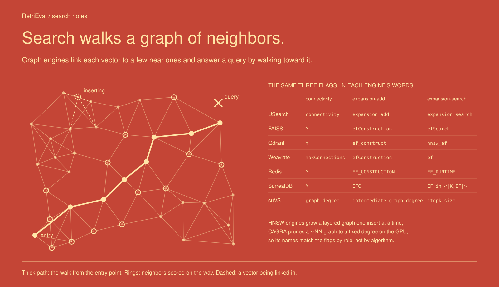
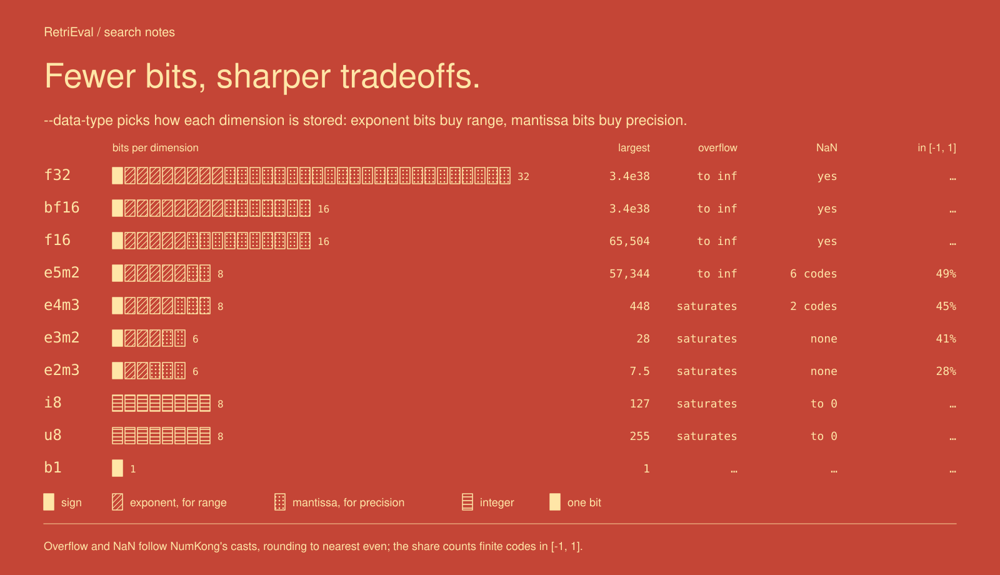
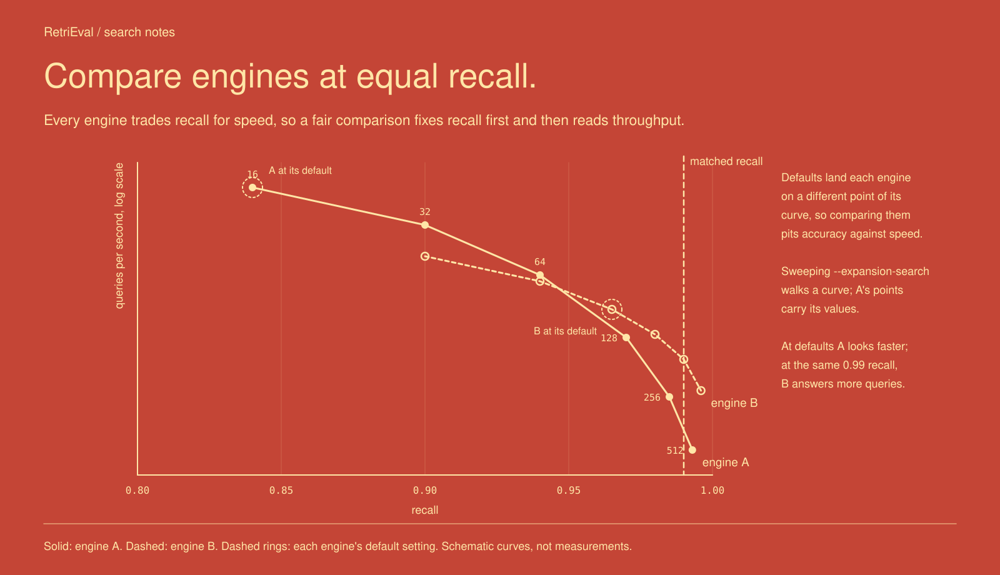
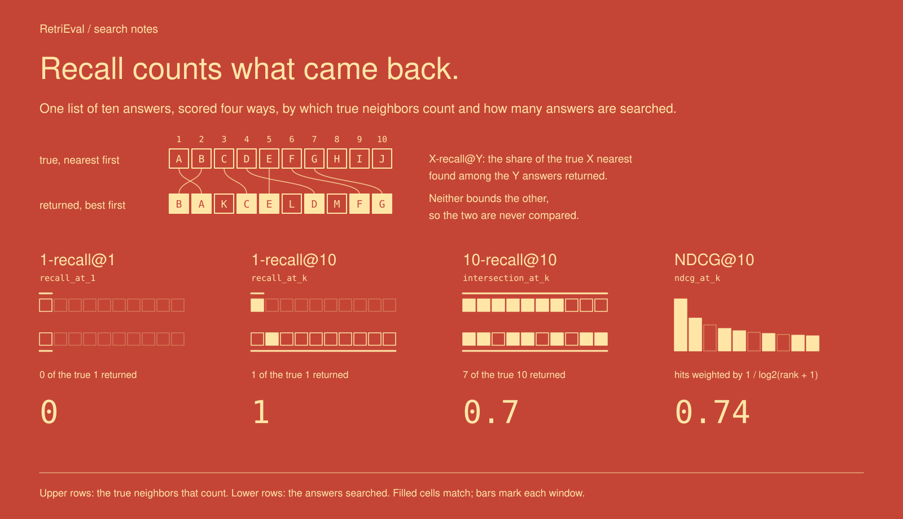

# RetriEval


__RetriEval__ benchmarks vector search at billion scale, from in-process search engines to databases.
It is a sibling of [CrudEval](https://github.com/ashvardanian/CrudEval), [TablEval](https://github.com/ashvardanian/TablEval) and [ServEval](https://github.com/ashvardanian/ServEval).
It compares [USearch](https://github.com/unum-cloud/usearch), [FAISS](https://github.com/facebookresearch/faiss) and [cuVS](https://github.com/NVIDIA/cuvs) on CPUs and GPUs, and [Qdrant](https://github.com/qdrant/qdrant), [Weaviate](https://github.com/weaviate/weaviate) and [Redis](https://github.com/redis/redis) as servers.
Runs shuffle construction, judge recall against exact ground truth, and write machine and budget details beside every number.

## Quickstart

Install the default `retri-eval-usearch` binary:

```sh
cargo install --path .
```

Fetch the Unum Wiki 1M dataset — ~1.1 GB of vectors, queries, and ground truth — into `data/wiki-1m/`:

```sh
scripts/download.sh wiki-1m
```

Run a sweep over three quantizations and write JSON reports under `results/`:

```sh
retri-eval-usearch \
    --base-vectors data/wiki-1m/base.1M.fbin \
    --query-vectors data/wiki-1m/query.public.100K.fbin \
    --query-neighbors data/wiki-1m/groundtruth.public.100K.ibin \
    --data-type bf16,f16,i8 \
    --metric inner \
    --output results/
```

Generate plots from the results:

```sh
uv run scripts/plot.py results/ --output plots/
```

## Backends

### Search Engines

| Backend     | Parallelism | Quantization                                  | Metrics                                     |
| :---------- | :---------- | :-------------------------------------------- | :------------------------------------------ |
| __USearch__ | ForkUnion   | bf16, f16, e5m2, e4m3, e3m2, e2m3, i8, u8, b1 | inner, euclidean, angular, hamming, jaccard |
| __FAISS__   | OpenMP      | f32, f16, bf16, u8, i8, b1                    | inner, euclidean                            |
| __cuVS__    | CUDA        | f32, f16, i8, u8                              | euclidean, inner, angular                   |

- __USearch__: The input is stored in the `--data-type` quantization, converted on the fly.
  `e3m2` and `e2m3` occupy byte slots; `b1` is packed.
- __FAISS__: Input is always f32.
  `--data-type` selects the internal scalar quantizer (SQfp16, SQbf16, SQ8_direct, etc.).
- __cuVS__: Input is converted on the host to the `--data-type`, one of f32, f16, i8 or u8, before CAGRA builds on it.
  It reuses the shared `--connectivity`, `--expansion-add` and `--expansion-search` names and JSON keys, so its runs plot on the same axes as the HNSW backends.
  The mapping is an analogy, not an identity: `--expansion-add` is CAGRA's pre-prune candidate width rather than `ef_construction`, and `--expansion-search` its internal top-i list rather than `ef_search`.



```sh
retri-eval-usearch --data-type bf16 --metric euclidean ...
retri-eval-faiss --data-type f16 --metric euclidean ...
retri-eval-cuvs --metric euclidean ...
```



### Vector Databases

Server-side quantization is managed by the database engine, not the benchmark.
Binary quantization is deterministic `sign(x)` per dim, and scalar quantization is per-dim min/max — neither trains a codebook, so both stay inside the "no learned logic" constraint the rest of the benchmark holds for the native backends.
Product quantization is deliberately excluded everywhere.

| Backend       | Client                       | Docker Image                       | Metrics                | Wire dtype sweep                        | Server-side quantization   |
| ------------- | ---------------------------- | ---------------------------------- | ---------------------- | --------------------------------------- | -------------------------- |
| __Qdrant__    | `qdrant-client`, gRPC        | `qdrant/qdrant:v1.19.1`            | ip, l2, cos, manhattan | `f32`, `f16`, `u8`                      | `none`, `binary`, `scalar` |
| __Redis__     | `redis`, RESP                | `redis:8.10`                       | ip, l2, cos            | `f32`, `f64`, `f16`, `bf16`, `u8`, `i8` | —                          |
| __Weaviate__  | `reqwest`, REST              | `semitechnologies/weaviate:1.39.7` | ip, l2, cos            | `f32` only                              | `none`, `binary`           |
| __LanceDB__   | `lancedb`, in-process, Arrow | —                                  | ip, l2, cos            | `f32` only                              | — (exact scan) ¹           |
| __Turso__     | `turso = 0.8.1`, native Rust | —                                  | l2, cos                | `f32` only                              | — (exact scan)             |
| __SurrealDB__ | `reqwest`, HTTP SQL          | `surrealdb/surrealdb:v3.3.0`       | l2, cos                | `f32` only                              | — (HNSW)                   |

¹ LanceDB's Rust client — `lancedb 0.37` — exposes graph-based search only via `IvfHnswFlat` / `IvfHnswSq` / `IvfHnswPq`, all behind a k-means-trained IVF layer that cannot be disabled.
No pure-HNSW variant is offered, so this benchmark leaves LanceDB on plain `f32` + L2/IP/Cos until upstream adds one.
Hamming is only available on `IvfFlat`, outside our graph path.

Turso runs in-process with exact `f32` scans over an in-memory database, or a file in `--data-dir` whose benchmark table alone is recreated; it measures exact search, not a libSQL ANN index.
The server backends run in Docker containers the binaries manage themselves; [`docker/README.md`](docker/README.md) covers their lifecycle and per-server caveats.

### Text Engines

Text runs index UTF-8 files of one entry per line, the line number being the row, as StringKilla's bases and tasks lay them out.
Each query names one target row, and only that row is credited, so a tie or a duplicate ranked above it costs the query.
The reports keep `recall_at_1` and `recall_at_k` as success@1 and success@k, and add `mrr_at_k`.

- `retri-eval-tantivy` holds a Tantivy index in RAM, splits each query by the field's analyzer into `Should` terms, and merges into one segment after the last insert.
  Tantivy scores fuzzy matches as a constant, so `--fuzziness` adds that constant to the exact terms' BM25 rather than blending BM25 over the edits as Lucene does.
- `retri-eval-elasticsearch` runs Elasticsearch 8.17 in Docker, on Lucene 9.12, with one shard: `_bulk` inserts, `_refresh` on flush, `_forcemerge` to one segment after the last insert, and one `_msearch` of `match` queries per batch.

```sh
retri-eval-tantivy \
    --base-texts data/en-wiked.txt \
    --query-texts tasks/wiked-similar/queries.txt \
    --query-targets tasks/wiked-similar/targets.txt \
    --fuzziness 0,AUTO \
    --output results/
```

---

Each backend is behind its own feature flag.
Build only what you need:

```sh
cargo build --release --features usearch-backend    # USearch
cargo build --release --features usearch-cuda       # USearch with its CUDA kernels, for --residency vram
cargo build --release --features faiss-backend      # FAISS
cargo build --release --features qdrant-backend     # Qdrant
cargo build --release --features redis-backend      # Redis
cargo build --release --features lancedb-backend    # LanceDB
cargo build --release --features weaviate-backend   # Weaviate
cargo build --release --features cuvs-backend       # cuVS
cargo build --release --no-default-features --features turso-backend # Turso
cargo build --release --no-default-features --features surrealdb-backend # SurrealDB
cargo build --release --no-default-features --features tantivy-backend # Tantivy
cargo build --release --no-default-features --features elasticsearch-backend # Elasticsearch
cargo build --release --no-default-features --features ground-truth # retri-ground-truth
```

Or combine multiple:

```sh
cargo build --release --features usearch-backend,faiss-backend,qdrant-backend
```

## Datasets

RetriEval works with the same plain input format standardized by the [BigANN benchmark](https://big-ann-benchmarks.com/).
The BigANN collections are a good starting point, as most ship pre-computed ground-truth neighbors for recall evaluation.
The tables below group the datasets by scale, and each name links to its download and run recipe in [`data/README.md`](data/README.md), which also covers the file format and sharded inputs.

### ~1M Scale

| Dataset                         | Scalar Type | Dimensions | Metric | Base Size | Ground Truth      |
| :------------------------------ | ----------: | ---------: | -----: | --------: | :---------------- |
| [Unum UForm Wiki][unum-wiki-1m] |       `f32` |        256 |     IP |      1 GB | 100K queries, yes |
| [Arxiv with E5][unum-arxiv-2m]  |       `f32` |        768 |     IP |      7 GB | 2.3M queries, yes |

### ~10M Scale

| Dataset                              | Scalar Type | Dimensions |  Metric | Base Size | Ground Truth      |
| :----------------------------------- | ----------: | ---------: | ------: | --------: | :---------------- |
| [Meta BIGANN — SIFT][meta-bigann]    |        `u8` |        128 |      L2 |    1.2 GB | 10K queries, yes  |
| [Microsoft Turing-ANNS][msft-turing] |       `f32` |        100 |      L2 |    3.7 GB | 100K queries, yes |
| [Microsoft SpaceV][msft-spacev]      |        `i8` |        100 |      L2 |    0.9 GB | 30K queries, yes  |
| [Yandex Deep][yandex-deep]           |       `f32` |         96 |      L2 |    3.6 GB | 10K queries, yes  |
| [Cohere Wiki EN][cohere-wiki]        |        `b1` |       1024 | Hamming |    5.3 GB | self-sampled ¹    |

> ¹ These sources ship vectors without ground truth, so their `retri-download-*` binaries sample queries with a fixed seed and compute exact Hamming top-K.

### ~100M Scale

| Dataset                               | Scalar Type | Dimensions |  Metric | Base Size | Ground Truth      |
| :------------------------------------ | ----------: | ---------: | ------: | --------: | :---------------- |
| [Meta BIGANN — SIFT][meta-bigann]     |        `u8` |        128 |      L2 |     12 GB | 10K queries, yes  |
| [Microsoft Turing-ANNS][msft-turing]  |       `f32` |        100 |      L2 |     37 GB | 100K queries, yes |
| [Microsoft SpaceV][msft-spacev]       |        `i8` |        100 |      L2 |    9.3 GB | 30K queries, yes  |
| [Yandex Deep][yandex-deep]            |       `f32` |         96 |      L2 |     36 GB | 10K queries, yes  |
| [Unum WikiVerse][wikiverse] ²         |       `f16` |  128–4096³ |  Cos/IP |  95-505GB | pipeline pending  |
| [USearchMolecules PubChem][usm] MACCS |        `b1` |        168 | Hamming |    2.4 GB | self-sampled ¹    |
| [USearchMolecules PubChem][usm] ECFP4 |        `b1` |       2048 | Hamming |     29 GB | self-sampled ¹    |

> ² WikiVerse ships `.f16bin`, which RetriEval does not read yet.
> ³ nomic-embed at 768, arctic-embed and Qwen3 at 1024, e5-mistral at 4096; the ColBERT model's 128d per token needs multi-vector support.

### ~1B Scale

| Dataset                                    | Scalar Type | Dimensions |  Metric | Base Size | Ground Truth      |
| :----------------------------------------- | ----------: | ---------: | ------: | --------: | :---------------- |
| [Meta BIGANN — SIFT][meta-bigann]          |        `u8` |        128 |      L2 |    119 GB | 10K queries, yes  |
| [Microsoft Turing-ANNS][msft-turing]       |       `f32` |        100 |      L2 |    373 GB | 100K queries, yes |
| [Microsoft SpaceV][msft-spacev]            |        `i8` |        100 |      L2 |     93 GB | 30K queries, yes  |
| [Yandex Text-to-Image][yandex-t2i]         |       `f32` |        200 |     Cos |    750 GB | 100K queries, yes |
| [Yandex Deep][yandex-deep]                 |       `f32` |         96 |      L2 |    358 GB | 10K queries, yes  |
| [USearchMolecules GDB-13][usm] MACCS       |        `b1` |        168 | Hamming |     21 GB | self-sampled ¹    |
| [USearchMolecules GDB-13][usm] ECFP4       |        `b1` |       2048 | Hamming |    250 GB | self-sampled ¹    |
| [USearchMolecules Enamine REAL][usm] MACCS |        `b1` |        168 | Hamming |    127 GB | self-sampled ¹    |
| [USearchMolecules Enamine REAL][usm] ECFP4 |        `b1` |       2048 | Hamming |   1.55 TB | self-sampled ¹    |

[unum-wiki-1m]: data/README.md#unum-uform-wiki
[unum-arxiv-2m]: data/README.md#arxiv-with-e5
[meta-bigann]: data/README.md#meta-bigann-sift
[msft-turing]: data/README.md#microsoft-turing-anns
[msft-spacev]: data/README.md#microsoft-spacev
[yandex-deep]: data/README.md#yandex-deep
[yandex-t2i]: data/README.md#yandex-text-to-image
[usm]: data/README.md#usearchmolecules
[cohere-wiki]: data/README.md#cohere-wikipedia-multilingual
[wikiverse]: data/README.md#unum-wikiverse

### Keys & Order

Keys stay as wide as their input: a keys file is memory-mapped at its own width, and generated keys are computed from the row on demand, so neither costs memory per row.
`uuid-v7` keys hold the row in their timestamp and counter, so they sort as rows do, while `uuid-v4` keys scatter over the whole key space.
Each engine stores keys natively where it can:

- __USearch__ takes every key as its 16-byte `Key`.
- __Qdrant__ keeps keys that fit 64 bits as numeric point ids and the rest as UUID point ids.
- __Weaviate and SurrealDB__ use each key as the object or record UUID, integers zero-padded.
- __Redis__ spells keys as UUIDs in the hash names.
- __LanceDB__ sizes its `id` column to `UInt32`, `UInt64` or `FixedSizeBinary(16)`.
- __FAISS, cuVS and Turso__ store base rows as their ids and name hits by the rows' keys, so keys of any width cost them nothing; cuVS saves those rows to a `.rows` file beside its index.

Duplicate keys suit USearch and the engines that store rows, FAISS, cuVS and Turso, since the others overwrite a repeated id.

`--insertion-order shuffled` is a seeded Feistel permutation computed per position, so a shuffle of any size stores nothing per row.

## Results

These numbers were measured for reference on DGX-B300 and DGX-H100 class nodes, the main drivers of AI neoclouds, on dual-socket Intel Xeon 6 hosts, and on single-socket AWS Graviton4 and Graviton5 hosts, and mostly guide the design of USearch.
They shift with the data, the software versions and the hardware, so treat them as reference points for your own runs, not as fixed rankings.
Every row comes from a dated run in [`CHANGELOG.md`](CHANGELOG.md), which also keeps each run's connectivity, K-recall@10 and build time.
Rows that build faster than they search, and ECFP4 rows under 99%, stay only there.

Each table holds one row per machine, core class, backend and type, so a new machine is a new row and nothing else moves:

- `Machine`: the host or GPU a run used, with its cores or SMs, threads and NUMA domains, like `AWS Graviton5, 192 cores, 192 threads, 2 domains` or `NVIDIA B300 SXM6, 148 SMs`.
  CPU rows count physical cores, not SMT threads, and name the threads where the run recorded them.
- `Class`: the capability class the report prints, like `apple-m2` or `blackwell`, or `-` where the run recorded none.
- `Backend`: the engine and its version.
- `Type`: the stored type; every backend took its native input type, with no rescaling.
- `Links`: the edges each vector keeps in the densest layer: 2×M in the HNSW graphs of USearch 2.25 and FAISS, M in the single-layer graphs of USearch 3.0 and cuVS.
- `Expansion`: the construction and search expansion, split by `/`.
- `Insertions` and `Queries`: vectors indexed and queries answered per second, in thousands or millions.
- `Recall@10`: 1-recall@10 as a percent, the share of queries whose true nearest neighbor lands in the top 10.
- `Memory`: the backend's own peak figure, which [`src/README.md`](src/README.md#memory-accounting) defines per backend.
- `Date`: the run day, which names its section in [`CHANGELOG.md`](CHANGELOG.md).
- A `-` marks a figure the run did not record.

Every new row follows the same methodology, which the April rows predate:

- Tune each backend's settings until it reaches 99% 1-recall@10 or more on the dataset.
- Never let a row build faster than it searches: when insertions outpace queries, raise the construction expansion and lower the search expansion until search is at least as fast at that recall.
- Run every command on a 1M prefix first, then on a 10M prefix, before the full file.
- Match the links each vector keeps: 64 means connectivity 64 in a single-layer graph and M=32 in HNSW.
- Start every engine from the same expansions, and widen the construction only where a dataset misses 0.99.
- Hold the 0.99 target on every dataset.
- Give each engine its best pages and kernels, and name them under the table.
- Build in 20 steps, and validate the ground truth against the base before the first insert.

Compare the fastest measured configuration meeting the same recall target, with the same recall definition, queries, K, and ground truth.
Report insertion throughput and memory alongside query throughput, and keep query concurrency, batch size, and cache state comparable.



Each search reports both recall conventions, because they answer different questions and one of them saturates:

- `recall_at_k` is 1-recall@K, FAISS's `OneRecallAtRCriterion` and the measure USearch reports: any of the top K within the true nearest distance.
- `intersection_at_k` is K-recall@K, the share of the top K within the K-th true distance, order-independent, and what ann-benchmarks and cuVS's own harness publish as recall.
- `ndcg_at_k` weights true hits by `1 / log2(rank + 1)`, normalized by ideal gain.
- Ties are counted by exact distance: the harness recomputes the distance of every true neighbor and every answer from the base vectors, whatever the engine stores, so a neighbor tied with a true one counts whichever key the ground truth kept, within a relative 10⁻⁶ for rounding.
- Neither 1-recall@K nor K-recall@K generally bounds the other, so the two are never interchangeable.
- K is `--top-k`, which defaults to the ground-truth file's width, 10 on the Wiki sets and 100 on the BigANN ones.
- 1-recall@K stops discriminating as K grows: at K=100 nearly any sane configuration finds the single true neighbor somewhere in the list.
  `intersection_at_k` stays informative there, and `ndcg_at_k` likewise normalizes over the full truth prefix.
- Pass `--top-k 10` for figures comparable across datasets of differing ground-truth width.



### 10M

PubChem MACCS, 168-bit `b1` fingerprints under Hamming, 10,000,000 molecules, with settings calibrated here and reused at 100M; recipes in [`data/README.md`](data/README.md#usearchmolecules).

| Machine                                        | Class | Backend    | Type | Links | Expansion |   Insertions |       Queries | Recall@10 | Memory | Date       |
| :--------------------------------------------- | :---- | :--------- | :--- | ----: | --------: | -----------: | ------------: | --------: | -----: | :--------- |
| Intel Xeon 6, 2 sockets, 96 cores, 192 threads | -     | FAISS 1.12 | `b1` |   128 |   40 / 16 | 95.230 k IPS | 293.795 k QPS |   96.610% | 7.6 GB | 2026-04-18 |

USearch 2.25 built faster than it searched there, so its row stays in the changelog.

SIFT, Meta's 128-dimensional `u8` descriptors under L2, 10,000,000 rows; recipes in [`data/README.md`](data/README.md#meta-bigann-sift).

| Machine                                             | Class | Backend      | Type  | Links | Expansion |    Insertions |       Queries | Recall@10 |  Memory | Date       |
| :-------------------------------------------------- | :---- | :----------- | :---- | ----: | --------: | ------------: | ------------: | --------: | ------: | :--------- |
| Intel Xeon 6, 2 sockets, 96 cores, 192 threads      | -     | USearch 2.25 | `u8`  |    32 | 128 / 256 |  35.405 k IPS |  80.729 k QPS |   99.380% |  4.4 GB | 2026-04-18 |
| Intel Xeon 6, 2 sockets, 96 cores, 192 threads      | -     | FAISS 1.12   | `u8`  |    32 | 128 / 256 |  26.374 k IPS |  38.278 k QPS |   99.520% |  5.9 GB | 2026-04-18 |
| NVIDIA B300 SXM6, 148 SMs                           | -     | cuVS 26.10   | `u8`  |    64 | 128 / 128 | 204.838 k IPS |   1.204 M QPS |         - |       - | 2026-10-21 |
| NVIDIA B300 SXM6, 148 SMs                           | -     | USearch 3.0  | `u8`  |    32 | 256 / 128 | 558.510 k IPS |   1.040 M QPS |   99.110% |  2.6 GB | 2026-10-21 |
| Intel Xeon 6768P, 2 sockets, 128 cores, 256 threads | -     | FAISS 1.15.1 | `u8`  |    64 |  128 / 96 | 115.643 k IPS | 133.919 k QPS |   99.000% |  8.6 GB | 2026-10-22 |
| Intel Xeon 6768P, 2 sockets, 128 cores, 256 threads | -     | FAISS 1.15.1 | `f32` |    64 |  128 / 96 |  59.688 k IPS |  61.027 k QPS |   99.000% | 14.4 GB | 2026-10-22 |

cuVS 26.10 ran through NVIDIA's `cuvs-bench` harness rather than `retri-eval-cuvs`, and reported only K-recall@10, 0.9966 here.
FAISS 1.15.1 ran from the `faiss-cpu` wheel, `u8` through `IndexHNSWSQ` with `QT_8bit_direct` and `f32` through `IndexHNSWFlat`, and its memory is the process's peak resident set, the memory-mapped base included.

Turing-ANNS, Microsoft's 100-dimensional `f32` web-search embeddings under L2, across storage types, 10,000,000 rows; recipes in [`data/README.md`](data/README.md#microsoft-turing-anns).

| Machine                                        | Class | Backend      | Type   | Links |   Expansion |   Insertions |       Queries | Recall@10 |  Memory | Date       |
| :--------------------------------------------- | :---- | :----------- | :----- | ----: | ----------: | -----------: | ------------: | --------: | ------: | :--------- |
| Intel Xeon 6, 2 sockets, 96 cores, 192 threads | -     | USearch 2.25 | `f32`  |    96 |   768 / 384 |  8.532 k IPS |  12.331 k QPS |   99.290% | 13.0 GB | 2026-04-20 |
| Intel Xeon 6, 2 sockets, 96 cores, 192 threads | -     | USearch 2.25 | `bf16` |    96 |   768 / 384 | 10.496 k IPS |  16.940 k QPS |   99.290% | 10.9 GB | 2026-04-20 |
| Intel Xeon 6, 2 sockets, 96 cores, 192 threads | -     | USearch 2.25 | `f16`  |    96 |   768 / 384 | 10.969 k IPS |  20.246 k QPS |   99.290% | 10.9 GB | 2026-04-20 |
| Intel Xeon 6, 2 sockets, 96 cores, 192 threads | -     | USearch 2.25 | `e5m2` |    96 |   768 / 384 | 10.526 k IPS |  20.534 k QPS |   99.190% |  9.8 GB | 2026-04-20 |
| Intel Xeon 6, 2 sockets, 96 cores, 192 threads | -     | USearch 2.25 | `e4m3` |    96 |   768 / 384 |  7.353 k IPS |  12.106 k QPS |   99.300% |  9.8 GB | 2026-04-20 |
| Intel Xeon 6, 2 sockets, 96 cores, 192 threads | -     | USearch 2.25 | `e3m2` |    96 |   768 / 384 | 10.398 k IPS |  18.022 k QPS |   97.280% |  9.8 GB | 2026-04-20 |
| Intel Xeon 6, 2 sockets, 96 cores, 192 threads | -     | USearch 2.25 | `e2m3` |    96 |   768 / 384 | 10.935 k IPS |  21.313 k QPS |   79.410% |  9.8 GB | 2026-04-20 |
| Intel Xeon 6, 2 sockets, 96 cores, 192 threads | -     | FAISS 1.12   | `f32`  |    96 |   768 / 384 |  7.491 k IPS |  16.486 k QPS |   99.440% | 14.1 GB | 2026-04-20 |
| Intel Xeon 6, 2 sockets, 96 cores, 192 threads | -     | FAISS 1.12   | `bf16` |    96 |   768 / 384 |  3.800 k IPS |  10.391 k QPS |   99.440% | 12.1 GB | 2026-04-20 |
| Intel Xeon 6, 2 sockets, 96 cores, 192 threads | -     | FAISS 1.12   | `f16`  |    96 |   768 / 384 |  2.545 k IPS |  10.032 k QPS |   99.440% | 12.1 GB | 2026-04-20 |
| NVIDIA B300 SXM6, 148 SMs                      | -     | USearch 3.0  | `bf16` |    32 | 1024 / 1024 | 95.870 k IPS | 155.810 k QPS |   99.080% |  3.4 GB | 2026-10-21 |

The `e3m2` and `e2m3` rows keep the settings of the other types and fall short of 99%.

### 100M

PubChem MACCS, 168-bit `b1` fingerprints under Hamming, 100,000,000 molecules, at the settings calibrated at 10M; recipes in [`data/README.md`](data/README.md#usearchmolecules).

| Machine                                        | Class | Backend      | Type | Links | Expansion |    Insertions |      Queries | Recall@10 |  Memory | Date       |
| :--------------------------------------------- | :---- | :----------- | :--- | ----: | --------: | ------------: | -----------: | --------: | ------: | :--------- |
| Intel Xeon 6, 2 sockets, 96 cores, 192 threads | -     | USearch 2.25 | `b1` |    64 |  128 / 64 |  35.080 k IPS | 38.432 k QPS |   84.380% | 40.8 GB | 2026-04-18 |
| Intel Xeon 6, 2 sockets, 96 cores, 192 threads | -     | FAISS 1.12   | `b1` |   128 |   40 / 16 |             - |            - |         - | ≥ 63 GB | 2026-04-18 |
| NVIDIA B300 SXM6, 148 SMs                      | -     | USearch 3.0  | `b1` |    32 |  256 / 64 | 559.140 k IPS |  1.460 M QPS |   99.070% | 18.3 GB | 2026-10-21 |

FAISS 1.12 was killed after 9 hours, past the memory shown.

PubChem ECFP4, 2048-bit `b1` fingerprints under Hamming, all 115,627,256 molecules; recipes in [`data/README.md`](data/README.md#usearchmolecules).

| Machine                   | Class | Backend     | Type | Links | Expansion |    Insertions |       Queries | Recall@10 |  Memory | Date       |
| :------------------------ | :---- | :---------- | :--- | ----: | --------: | ------------: | ------------: | --------: | ------: | :--------- |
| NVIDIA B300 SXM6, 148 SMs | -     | USearch 3.0 | `b1` |    32 | 512 / 512 | 146.810 k IPS | 285.230 k QPS |   99.060% |       - | 2026-10-21 |
| AWS Graviton4, 84 cores   | -     | USearch 3.0 | `b1` |    64 | 512 / 512 |  41.008 k IPS |  49.048 k QPS |   99.310% | 68.6 GB | 2026-11-13 |

Both Graviton5 rows and the Graviton4 FAISS row miss 99%, so they stay in the changelog with the reasons.

SIFT, Meta's 128-dimensional `u8` descriptors under L2, 100,000,000 rows; recipes in [`data/README.md`](data/README.md#meta-bigann-sift).

| Machine                                          | Class      | Backend      | Type | Links | Expansion |    Insertions |       Queries | Recall@10 |  Memory | Date       |
| :----------------------------------------------- | :--------- | :----------- | :--- | ----: | --------: | ------------: | ------------: | --------: | ------: | :--------- |
| Intel Xeon 6, 2 sockets, 96 cores, 192 threads   | -          | USearch 2.25 | `u8` |    32 | 128 / 256 |  39.831 k IPS |  75.808 k QPS |   98.330% | 53.7 GB | 2026-04-18 |
| Intel Xeon 6, 2 sockets, 96 cores, 192 threads   | -          | FAISS 1.12   | `u8` |    32 | 128 / 256 |             - |             - |         - | ≥ 46 GB | 2026-04-18 |
| NVIDIA B300 SXM6, 148 SMs                        | -          | cuVS 26.10   | `u8` |    64 | 128 / 256 | 154.799 k IPS | 582.000 k QPS |         - |       - | 2026-10-21 |
| NVIDIA B300 SXM6, 148 SMs                        | -          | USearch 3.0  | `u8` |    32 | 256 / 256 | 431.520 k IPS | 604.490 k QPS |   99.130% | 24.8 GB | 2026-10-21 |
| AWS Graviton5, 192 cores, 192 threads, 2 domains | `apple-m2` | USearch 3.0  | `u8` |    32 | 512 / 160 | 161.952 k IPS | 173.823 k QPS |   99.250% | 33.8 GB | 2026-11-09 |
| AWS Graviton5, 192 cores, 192 threads, 2 domains | -          | FAISS 1.15.1 | `u8` |    64 | 256 / 128 |  84.536 k IPS | 178.600 k QPS |   99.170% | 56.9 GB | 2026-11-09 |
| AWS Graviton4, 84 cores                          | -          | USearch 3.0  | `u8` |    64 | 128 / 128 | 185.046 k IPS | 208.835 k QPS |   99.210% | 46.7 GB | 2026-11-13 |
| AWS Graviton4, 84 cores                          | -          | FAISS 1.15.1 | `u8` |    64 | 256 / 128 |  41.917 k IPS |  93.549 k QPS |   99.120% | 42.3 GB | 2026-11-13 |

FAISS 1.12 was killed after 9 hours, past the memory shown.
cuVS 26.10 ran through NVIDIA's `cuvs-bench` harness rather than `retri-eval-cuvs`, and reported only K-recall@10, 0.9963 here.
USearch on Graviton5 keeps 32 links, half the 64 the methodology matches, and FAISS there was built from source with its SVE kernels and OpenBLAS.

SpaceV, Microsoft's 100-dimensional `i8` web-search embeddings under L2, 100,000,000 rows; recipes in [`data/README.md`](data/README.md#microsoft-spacev).

| Machine                 | Class | Backend      | Type | Links | Expansion |   Insertions |      Queries | Recall@10 |  Memory | Date       |
| :---------------------- | :---- | :----------- | :--- | ----: | --------: | -----------: | -----------: | --------: | ------: | :--------- |
| AWS Graviton4, 84 cores | -     | USearch 3.0  | `i8` |    64 | 512 / 384 | 38.713 k IPS | 57.971 k QPS |   99.340% | 45.1 GB | 2026-11-13 |
| AWS Graviton4, 84 cores | -     | FAISS 1.15.1 | `i8` |    64 | 512 / 640 | 14.975 k IPS | 15.773 k QPS |   99.120% | 39.5 GB | 2026-11-13 |

Deep, Yandex's 96-dimensional `f32` image embeddings under L2, stored as `bf16` by both backends, 100,000,000 rows; recipes in [`data/README.md`](data/README.md#yandex-deep).

| Machine                 | Class | Backend      | Type   | Links | Expansion |   Insertions |       Queries | Recall@10 |  Memory | Date       |
| :---------------------- | :---- | :----------- | :----- | ----: | --------: | -----------: | ------------: | --------: | ------: | :--------- |
| AWS Graviton4, 84 cores | -     | USearch 3.0  | `bf16` |    64 | 256 / 192 | 87.964 k IPS | 118.976 k QPS |   99.340% | 53.1 GB | 2026-11-13 |
| AWS Graviton4, 84 cores | -     | FAISS 1.15.1 | `bf16` |    64 | 256 / 256 | 48.503 k IPS |  56.920 k QPS |   99.290% | 48.6 GB | 2026-11-13 |

Turing-ANNS, Microsoft's 100-dimensional `f32` web-search embeddings under L2, across storage types, 100,000,000 rows; recipes in [`data/README.md`](data/README.md#microsoft-turing-anns).

| Machine                                        | Class | Backend      | Type   | Links |   Expansion |   Insertions |       Queries | Recall@10 |   Memory | Date       |
| :--------------------------------------------- | :---- | :----------- | :----- | ----: | ----------: | -----------: | ------------: | --------: | -------: | :--------- |
| Intel Xeon 6, 2 sockets, 96 cores, 192 threads | -     | USearch 2.25 | `f32`  |    96 |   768 / 384 |  6.646 k IPS |  10.398 k QPS |   99.290% | 139.6 GB | 2026-04-20 |
| Intel Xeon 6, 2 sockets, 96 cores, 192 threads | -     | USearch 2.25 | `bf16` |    96 |   768 / 384 |  8.564 k IPS |  14.772 k QPS |   99.310% | 105.2 GB | 2026-04-20 |
| Intel Xeon 6, 2 sockets, 96 cores, 192 threads | -     | USearch 2.25 | `f16`  |    96 |   768 / 384 |  8.807 k IPS |  15.412 k QPS |   99.300% | 105.2 GB | 2026-04-20 |
| Intel Xeon 6, 2 sockets, 96 cores, 192 threads | -     | USearch 2.25 | `e5m2` |    96 |   768 / 384 |  7.368 k IPS |  13.227 k QPS |   99.240% |  88.0 GB | 2026-04-20 |
| NVIDIA B300 SXM6, 148 SMs                      | -     | USearch 3.0  | `bf16` |    32 | 1024 / 1024 | 88.660 k IPS | 156.790 k QPS |   99.330% |  32.1 GB | 2026-10-21 |

## CLI Reference

Each backend is a separate binary, and the manuals below list every flag of every binary with its default.
A value spelled `<…,...>` takes comma-separated values and runs one configuration per combination.
Counts take `K`, `M`, `G` or `T` in powers of 1000, like `10M`, and sizes take `KB` to `TB` in powers of 1024, like `16GB`.
A zero connectivity or expansion lets USearch derive it, and the report records the connectivity the index header holds.
A bad value prints `--flag="value" does not parse, expected …` and exits with status 1.
A sweep also exits with status 1 when any configuration fails or none runs, while configurations a backend refuses to open are reported as skipped.
Every `retri-eval-*` flag also reads `RETRIEVAL_<FLAG>` as its default, upper-cased with dashes as underscores, so `--top-k` reads `RETRIEVAL_TOP_K`.
The flag on the command line overrides the variable, and switches like `--self-search` read `1`, `0`, `true` or `false`.

<details>
<summary>Shared by every <code>retri-eval-*</code> binary</summary>

```text
retri-eval-* over vectors
  --base-vectors <PATH|GLOB>            required
      Base vectors to index: .fbin, .u8bin, .i8bin or .b1bin.
  --query-vectors <PATH|GLOB>           required
      Query vectors to search with.
  --query-neighbors <PATH|GLOB>         required
      Ground-truth neighbor rows for those queries: .ibin, or .u64bin past 2^32 base rows;
      or .txt of one target row per query.
  --max-base-vectors <N>                all
      Cap on the base vectors used, for calibration on a slice.
  --dims <N,...>                        native
      Matryoshka truncations, each at most the native width, and a multiple of 8 for .b1bin.

retri-eval-tantivy, retri-eval-elasticsearch
  --base-texts <PATH>                   required
      Base entries to index: UTF-8, one per line, the line number being the row.
  --query-texts <PATH>                  required
      Query entries to search with, one per line.
  --query-targets <PATH>                required
      Each query's target base row, one zero-based row per line.
  --max-base-entries <N>                all
      Cap on the base entries used, for calibration on a slice.

retri-eval-*
  --base-keys <PATH|GLOB>               generated
      Keys for the base rows, one per row: .i32bin, .u64bin or .uuidbin.
  --key-type <TYPE>                     u32
      Keys generated without --base-keys: u32, u64, uuid-v4 or uuid-v7.
  --top-k <K>                           ground-truth width, or 10 under targets
      Neighbors per query, the K every metric is taken at; at most the ground-truth width
      under neighbors, unbounded under targets.
  --insertion-order <ORDER>             shuffled
      shuffled by --seed, or the file's original order.
  --seed <SEED>                         42
      32-bit seed of the shuffled order, or random; rejected with --insertion-order original.
  --steps <N>                           10
      Measurement steps; the base is inserted in this many equal parts.
  --inserts-per-core <N>                2048
      Entries per add call for each backend thread: --threads on usearch, faiss and tantivy, one elsewhere.
  --queries-per-core <N>                2048
      Queries per search call for each backend thread: --threads on usearch, faiss and tantivy, one elsewhere.
  --output <DIR>                        none
      Directory for JSON result files; progress only when unset.
  --memory-limit <SIZE>                 cgroup memory.max, else all RAM
      Memory the engine may use, page cache included, like 16GB; servers get it as their
      container's memory and swap limit, beside the process's CPU affinity as their cpuset.
  --perf-counters                       off
      Record hardware counters per phase; needs the perf-counters feature on Linux.
  --self-search                         off
      After the last insertion, replay indexed entries as their own queries.
  --self-search-top-k <K>               10
      Neighbors per self-search query.
  --self-search-sample <N|FRACTION>     all
      Leading base rows to replay, a count like 50000 or a fraction like 0.1; needs --self-search.
```

</details>

<details>
<summary>Search engines: <code>retri-eval-usearch</code>, <code>retri-eval-faiss</code> & <code>retri-eval-cuvs</code></summary>

```text
retri-eval-usearch, retri-eval-faiss, retri-eval-cuvs
  --index <PATH>                        none
      Persisted index: searched if the path exists, else built and saved; needs a single config.

retri-eval-usearch
  --data-type <TYPE,...>                bf16
      Stored type: bf16, f16, e5m2, e4m3, e3m2, e2m3, i8, u8 or b1.
  --metric <METRIC,...>                 euclidean
      inner, euclidean, angular, hamming or jaccard; ip, l2, cos and tanimoto also parse.
  --connectivity <N,...>                0
      Graph connectivity, 0 to let USearch derive it.
  --expansion-add <N,...>               0
      Construction expansion, 0 to let USearch derive it.
  --expansion-search <N,...>            0
      Search expansion, 0 to let USearch derive it.
  --memory-domains <NODES>              every node the process may use
      Comma-separated NUMA nodes, one shard on each.
  --threads <N,...>                     0
      Threads, 0 for every core in the affinity mask.
  --residency <WHERE>                   ram
      ram, vram, or nvme: built in RAM, saved to --index and searched as a view on the last step.
  --max-refines <N>                     0
      Refinement rounds after the last insert step, stopping at the first that does not improve the graph.
  --nvme-paths <PATHS>                  where --index points
      Devices or directories an NVMe view serves its parts from.
  --devices <ORDINALS>                  one free device
      GPU ordinals, one shard on each.

retri-eval-faiss
  --data-type <TYPE,...>                bf16
      Scalar quantizer over f32 input: f32, f16, bf16, u8, i8 or b1.
  --metric <METRIC,...>                 euclidean
      inner or euclidean, also spelled ip and l2; b1 data always uses Hamming.
  --connectivity <N,...>                32
      HNSW M.
  --expansion-add <N,...>               128
      HNSW construction width.
  --expansion-search <N,...>            64
      HNSW search width.
  --threads <N>                         0
      OpenMP threads, 0 for every core in the affinity mask.

retri-eval-cuvs
  --data-type <TYPE,...>                f32
      f32, f16, i8 or u8, converted on the host before CAGRA builds on it.
  --metric <METRIC,...>                 euclidean
      euclidean, inner or angular, also spelled l2, ip and cos.
  --connectivity <N,...>                32
      CAGRA's output graph degree.
  --expansion-add <N,...>               64
      CAGRA's intermediate graph degree before pruning.
  --expansion-search <N,...>            64
      CAGRA's internal top-i list.
  --search-width <N|auto,...>           auto
      Graph nodes that start each search iteration, or auto for cuVS's choice.
  --min-iterations <N>                  cuVS's choice
      Minimum search iterations.
  --max-iterations <N>                  cuVS's choice
      Maximum search iterations.
  --num-random-samplings <N>            cuVS's choice
      Random sampling rounds for the initial search points.
  --build-algo <ALGORITHM>              auto
      Graph build algorithm, auto or nn_descent.
  --devices <ORDINALS>                  0
      GPU ordinals; CAGRA builds and searches on the first.
```

</details>

<details>
<summary>Vector databases: <code>retri-eval-qdrant</code>, <code>-redis</code>, <code>-weaviate</code>, <code>-surrealdb</code>, <code>-lancedb</code> & <code>-turso</code></summary>

```text
retri-eval-qdrant, retri-eval-redis, retri-eval-weaviate, retri-eval-surrealdb
  --startup-time-limit <DURATION>       120s
      Time limit for container start and readiness.
  --connectivity <N,...>                16
      HNSW M.
  --expansion-add <N,...>               128
      HNSW construction width.
  --expansion-search <N,...>            64
      HNSW search width.

retri-eval-qdrant
  --data-type <TYPE,...>                f32
      Storage type: f32, f16 or u8.
  --metric <METRIC,...>                 l2
      ip, cos, l2 or manhattan.
  --quantization <MODE,...>             none
      Server-side none, binary or scalar.
  --grpc-port <PORT>                    6334
      Host gRPC port.
  --http-port <PORT>                    6333
      Host HTTP port.
  --vectors-per-upsert <N>              10000
      Vectors per upsert request.

retri-eval-redis
  --data-type <TYPE,...>                f32
      f32, f64, f16, bf16, u8 or i8; u8 and i8 need Redis 8.
  --metric <METRIC,...>                 l2
      l2, ip or cos.
  --port <PORT>                         6379
      Host port.
  --vectors-per-upsert <N>              1000
      Vectors per pipeline flush.

retri-eval-weaviate
  --metric <METRIC,...>                 l2
      l2, ip or cos.
  --quantization <MODE,...>             none
      Server-side none or binary.
  --port <PORT>                         8080
      Host HTTP port.

retri-eval-surrealdb
  --metric <METRIC,...>                 l2
      l2 or cos.
  --port <PORT>                         8000
      Host HTTP port.

retri-eval-lancedb
  --metric <METRIC>                     l2
      One of ip, cos or l2.
  --data-dir <DIR>                      data
      LanceDB storage directory.

retri-eval-turso
  --metric <METRIC>                     l2
      One of l2 or cos.
  --data-dir <DIR>                      in memory
      Directory of the Turso database file; only its bench table is recreated.
```

</details>

<details>
<summary>Text engines: <code>retri-eval-tantivy</code> & <code>retri-eval-elasticsearch</code></summary>

```text
retri-eval-tantivy, retri-eval-elasticsearch
  --fuzziness <EDITS,...>               0
      Edits a query term may differ by: 0, 1, 2, or AUTO for none up to 2 characters, one up to 5
      and two beyond, as Elasticsearch spells it.

retri-eval-tantivy
  --threads <N,...>                     0
      Search threads, 0 for every core in the affinity mask; Tantivy picks its own indexing threads.
  --writer-memory <SIZE>                1GB
      Memory the index writer buffers before it writes a segment, a budget `Index::writer` requires.

retri-eval-elasticsearch
  --startup-time-limit <DURATION>       120s
      Time limit for container start and readiness.
  --port <PORT>                         9200
      Host HTTP port.
```

</details>

<details>
<summary>Dataset tools: <code>retri-generate</code>, <code>retri-ground-truth</code>, <code>retri-download-molecules</code> & <code>retri-download-cohere</code></summary>

```text
retri-generate, retri-download-molecules, retri-download-cohere
  --threads <N>                         0
      Ground-truth threads, 0 for all cores.
  --seed <SEED>                         42
      32-bit seed of generation or query sampling, or random.
  --output <DIR>                        required
      Output directory.

retri-generate
  --format <FORMAT>                     required
      b1bin for clustered binary with Hamming ground truth, or fbin for Gaussian f32 with L2.
  --base-count <N>                      required
      Base vectors to generate.
  --query-count <N>                     required
      Query vectors to generate.
  --dims <N>                            required
      Bits for b1bin, a multiple of 8, or scalars for fbin.
  --clusters <N>                        256
      Cluster centers.
  --noise <PROBABILITY>                 0.1
      Bit-flip probability from 0 to 1.
  --top-k <K>                           10
      Neighbors per query in the ground-truth file.

retri-ground-truth
  --base-vectors <PATH|GLOB>            required
      Base vectors: .fbin, .u8bin, .i8bin or .b1bin.
  --query-vectors <PATH>                required
      Query vectors of the base's scalar type and width.
  --metric <METRIC>                     required
      euclidean over .fbin, .i8bin and .u8bin, or hamming over .b1bin.
  --top-k <K>                           100
      Neighbors per query in the ground-truth file.
  --threads <N>                         0
      Ground-truth threads, 0 for all cores.
  --output <PATH>                       required
      Ground-truth file to write: neighbor rows, then their distances.

retri-download-molecules, retri-download-cohere
  --query-count <N>                     10000
      Queries sampled from the base, along with the ground truth.
  --limit <N>                           all
      Rows to extract.
  --download-concurrency <N>            4
      Concurrent shard downloads.
  --keep-parquet                        off
      Keep the Parquet shards under <output>/parquet/.

retri-download-molecules
  --source <SOURCE>                     required
      pubchem (115M), gdb13 (977M) or enamine (6.04B).
  --fingerprint <COLUMN>                required unless --conformers
      maccs (166 bits), pubchem (881), ecfp4 (2048) or fcfp4 (2048).
  --conformers                          off
      Each embedded molecule's lowest-energy conformer, as base.part_N.f16bin xyz points beside
      counts.part_N.ibin points per cloud; excludes --fingerprint and --top-k. With
      --query-count, also query.N.f16bin and query.N.counts.ibin of N sampled clouds.
  --top-k <K>                           none
      Neighbors per query in the ground-truth file, which only this flag writes.
  --hold-out                            off
      Move the sampled queries out of the base parts first, so the truth covers the rest.
  --part-rows <N>                       512000000
      Rows per base part, a multiple of the bucket's 1M-row shards.
  --url-prefix <URL>                    the public bucket
      S3 or HTTPS prefix of the shards.

retri-download-cohere
  --top-k <K>                           10
      Neighbors per query in the ground-truth file.
  --language <CODE>                     en
      Language config of the Hugging Face dataset.
  --no-text                             off
      Skip the aligned titles.txt, texts.txt and urls.txt.
```

</details>

### Self-Recall

`--self-search` answers a different question from `--query-neighbors`, and closes two gaps the ground-truth path leaves open.

Shipped query files are small — SIFT has 10K queries, a single batch finishing in under a tenth of a second on a modern GPU.
A QPS figure measured over that burst is real, but says nothing about sustained throughput.
Self-recall replays indexed vectors as queries, so an unsampled 100M-vector index issues 100M queries, making it the only phase in a report measured under load.
Use `--self-search-sample` to cap the sweep (e.g. `0.1` for a tenth, or `50000` for an absolute count) when a full pass is too slow, as it is on the server backends.

It is also the metric that survives `--max-base-vectors` most cleanly.
Ground-truth files name neighbors drawn from the whole published base, so capping a run to a slice drags recall down by roughly the cap ratio no matter how good the index is — a quarter-size slice of the SIFT base reports about 0.25, not 0.99.
The harness does not divide that back out: the correction would assume the indexed slice is a uniform sample of the base, and a leading-prefix cap is not one.
It reports the raw figure and, in `dataset.entries_count`, the divisor — coverage is `steps[].entries_indexed / dataset.entries_count`, plotted as `coverage.png`.
Self-recall needs no such correction at all: identity truth is computed against exactly the vectors that were inserted.

Three caveats are worth knowing before quoting the numbers.
Exact-duplicate vectors in the base can cost a hit, since either twin may take rank 1, so a self-recall below 1.0 bounds the index's error rate rather than measuring it exactly.
A self-query is a graph node rather than an out-of-sample point, so traversal converges faster than it would on real queries — treat the throughput as an optimistic bound, not as a substitute for a query-set measurement.
And `--self-search-sample` replays the _leading_ N rows rather than a random draw, because contiguous slices are what keep the queries zero-copy and the throughput figure clean.
On a base whose row order carries structure, only the default full sweep is unbiased.

Note also that a self-search's `recall_at_k` is very nearly redundant with its `recall_at_1`: a vector's own distance to itself is zero, which is minimal, so if the index retrieves it at all it lands at rank 1.
Raising `--self-search-top-k` therefore changes how much search work each query does — which is the point when you are measuring throughput — but not the recall value.

## Output Format

One JSON file per backend configuration, written to `--output <dir>`.
Files are auto-named `<backend>-<hash>.json`.

```json
{
  "schema_version": 2, "started_unix_seconds": 1795046400,
  "machine": { "cpu_model": "Intel Xeon 6776P", "physical_cores": 96,
               "budget": { "cores": 192, "cpus": "0-191", "memory_limit": 549755813888 }, ... },
  "dataset": { "base_path": "...", "entries_count": 10000000, "base_bytes": 4000000000,
               "dimensions": 100, "truth": "neighbors", ... },
  "config": { "backend": "usearch", "data_type": "f32", "metric": "l2", "connectivity": 16,
              "dimensions": 100, "entries_count": 10000000, "top_k": 10, ... },
  "steps": [
    {
      "entries_indexed": 1000000,
      "memory_bytes": 412000000, "process_anon_bytes": 436000000,
      "add": { "elapsed": 12.3, "throughput": 81300 },
      "refine": { "passes": 2, "elapsed": 6.8, "changed": [412000, 61000] },
      "ground_truth_search": {
        "queries": 100000, "passes": 23, "top_k": 10,
        "elapsed": 5.1, "throughput": 451000,
        "recall_at_1": 0.0942, "recall_at_k": 0.2815,
        "intersection_at_k": 0.2611, "ndcg_at_k": 0.1847
      },
      "self_search": {
        "queries": 1000000, "passes": 1, "top_k": 10,
        "elapsed": 1.6, "throughput": 627541,
        "recall_at_1": 0.9958, "recall_at_k": 0.9961, "mrr_at_k": 0.9959
      }
    }
  ]
}
```

A step pairs the index state (`entries_indexed`, `memory_bytes`, `process_anon_bytes`) with the phases that acted on it.
`add.elapsed` includes the wait until a server finishes indexing what was added.
A ground-truth search runs one untimed pass to warm the index, then repeats every query until at least 5 seconds pass, and `passes` counts the timed ones.
`refine` appears on the last insert step when `--max-refines` ran refinement rounds, which stop at the first that does not improve the graph; `passes` counts the rounds that ran and `changed` the rows each one re-wired.
`add` is `null` on the `--index` load path, where nothing was inserted; `self_search` appears on at most one step — the last — because it runs once against the finished index, and that step is the index state it ran against.
Its metrics drop the `self_` prefix because the container already says it, and it carries no `intersection_at_k` or `ndcg_at_k`: identity truth is a single key per query, so neither a set overlap nor a ranked gain says anything beyond `recall_at_1`.
It carries `mrr_at_k` instead, the mean reciprocal rank of each query's own key within the top-k.
`dataset.truth` names the judge: `neighbors` rescores answers by exact distance, while `targets` credits only each query's target row, reporting success@1 and success@k as `recall_at_1` and `recall_at_k` beside `mrr_at_k`.

`dataset` describes the input files and `config` describes the run, so `dataset.entries_count` is the base file's row count while `config.entries_count` is what `--max-base-vectors` or `--max-base-entries` actually indexed; divide `steps[].entries_indexed` by the former for the share of the ground truth a step could possibly have found.
`dataset.dimensions` is likewise the file's width, and `config.dimensions` the width a `--dims` sweep truncated to; both are absent from text runs, while `dataset.base_bytes` counts the base rows' bytes in every run.

Building with `--features perf-counters` and passing `--perf-counters` adds per-phase hardware counters on Linux, and an external `perf stat` sidecar works on any build.
[`src/README.md`](src/README.md) covers both, along with how each backend measures `memory_bytes`, which differs from one backend to the next.

## Project Layout

```text
src/bench.rs                     Library root, shared benchmark infrastructure for every binary
src/dataset.rs                   Memory-mapped vectors and text corpora, key mappings, ground truth
src/eval.rs                      Recall, intersection and ranking metrics, by exact distance or target
src/ground_truth.rs              Exact top-K ground truth over NumKong's packed distance kernels
src/packed_distance.rs           One trait over NumKong's packed Hamming and Euclidean kernels
src/output.rs                    Typed reports, machine information and JSON serialization
src/error.rs                     Errors of dataset parsing and brute-force ground truth
src/perf_counters.rs             Optional scoped Linux hardware counters
src/docker.rs                    Container lifecycle for the server backends
src/download.rs                  HTTP shard fetching shared by the dataset downloaders
src/usearch.rs                   retri-eval-usearch
src/faiss.rs                     retri-eval-faiss
src/faiss.cpp                    Binary HNSW expansions that FAISS's C API leaves unreachable
src/cuvs.rs                      retri-eval-cuvs, over CAGRA
src/qdrant.rs                    retri-eval-qdrant
src/redis.rs                     retri-eval-redis, over RediSearch
src/weaviate.rs                  retri-eval-weaviate
src/lancedb.rs                   retri-eval-lancedb, in-process
src/turso.rs                     retri-eval-turso, exact search in-process
src/surrealdb.rs                 retri-eval-surrealdb
src/tantivy.rs                   retri-eval-tantivy, BM25 over text entries
src/elasticsearch.rs             retri-eval-elasticsearch, BM25 over text entries
src/generate.rs                  retri-generate, synthetic datasets with exact ground truth
src/compute_ground_truth.rs      retri-ground-truth, for an existing base and query set
src/README.md                    Hardware counters, perf stat sidecar and memory accounting
scripts/download.sh              Fetches a public dataset under the names the commands above use
scripts/download_molecules.rs    retri-download-molecules, USearchMolecules fingerprints and conformers
scripts/download_cohere.rs       retri-download-cohere, Cohere Wikipedia binary embeddings
scripts/plot.py                  SVG charts from the JSON reports
```

Directory guides describe [observability and memory accounting](src/README.md), [datasets](data/README.md), and [server backends](docker/README.md).

## Benchmark Pitfalls

- Throughput means nothing without its recall: an engine that looks faster at its default setting may answer fewer queries once both are swept to the same 0.99 recall, so [Results](#results) compares configurations at matched recall.
- An index that builds faster than it searches is under-built: raise the construction expansion and lower the search expansion until search is at least as fast at that recall.
- 1-recall@K and K-recall@K answer different questions, neither bounds the other, and 1-recall@K stops discriminating as K grows; pass `--top-k 10` for figures comparable across datasets.
- Shipped query files are small, so a QPS figure over one burst says nothing about sustained throughput; [self-recall](#self-recall) replays the base under load, but its traversal converges faster than on real queries.
- Capping a run with `--max-base-vectors` drags ground-truth recall down by roughly the cap ratio, which the harness reports rather than divides out.
- Each backend measures `memory_bytes` its own way, from an index's own figure to a container's anonymous bytes without the page cache, as [`src/README.md`](src/README.md#memory-accounting) details.
- On servers, `add.elapsed` includes the wait until the server finishes indexing what was added.
- Keep query concurrency, batch size and cache state comparable between engines.

## Remaining Scope

The following planned capabilities remain incomplete:

- A USearch sequence backend, scoring text entries by Levenshtein and Needleman-Wunsch inside this harness, waits for USearch's sequence index redesign.
- `.f16bin` inputs, which WikiVerse ships, along with its ground-truth pipeline.
- Multi-vector search, which WikiVerse's ColBERT embeddings need at 128 dimensions per token.
- Graph search on LanceDB, until upstream offers HNSW without a trained IVF layer.

## Development

The repository pins Rust 1.100.
CI runs `cargo fmt --check`, Ruff on the plotting script, then `cargo clippy` and `cargo test` per feature set; pass the same `--features` locally for optional native engines.
`src/` holds the shared library in `bench.rs`, one binary per backend and `retri-generate`, `scripts/` the dataset downloaders and plotting, `.githooks/` the Git hooks, and `docker/` the compose files for the server backends.
Arm the hooks once per clone with `git config core.hooksPath .githooks`.
The pre-commit hook checks the staged lines against the house style, with rustfmt, Ruff and markdownlint where they are installed.

## History

RetriEval began in 2023 as USearch Benchmarks, Python scripts comparing USearch with FAISS on the billion-vector Deep1B dataset, with adapters for HNSWlib, SCANN, LanceDB, Qdrant and Weaviate.
In 2026 it was rewritten in Rust as one executable per backend, with multi-configuration sweeps, one JSON report per configuration, and Redis and cuVS backends.
Version 3 moves to the USearch v3 dense index and drops client-side shards, in step with the USearch 3 line it measures.
